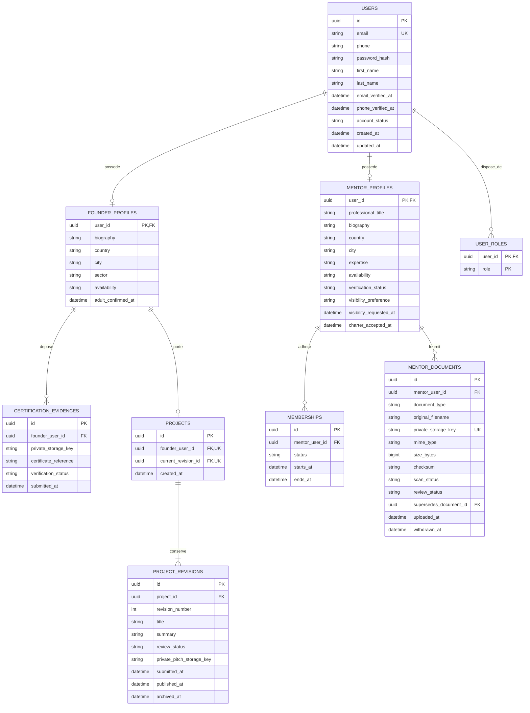
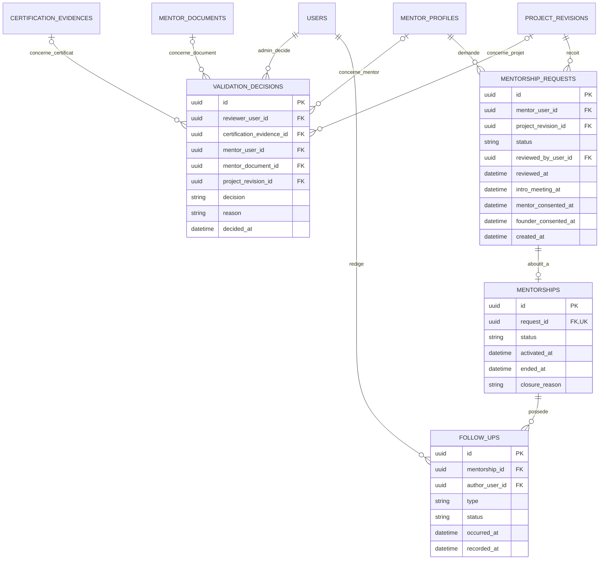

# Conex — MCD V1 et premières règles de données

Statut : MCD traduit en Prisma, avec migrations et services métier V1 implémentés.
Les migrations sont appliquées dans la base locale dédiée `conex`. Voir les
[notes de réalisation](prisma-v1.md) pour les garanties et les intégrations restantes.

Ce document formalise les règles précisées dans la conversation. Les propositions
qui restent à décider sont signalées explicitement. Les tables financières et le
module de dotations ne sont pas détaillés ici.

## 1. Règles retenues

- `users` porte les données communes aux comptes.
- `mentor_profiles` porte les données propres au mentor.
- Un mentor peut déposer plusieurs documents privés : CV et justificatifs de son
  expertise. Leur examen alimente la validation de sa candidature.
- `founder_profiles` porte les données propres au porteur de projet, avant,
  pendant et après son accompagnement. Ce nom ne dépend pas de l’existence d’un
  mentorat actif.
- Les deux tables de profils utilisent `user_id` comme clé primaire ET clé
  étrangère vers `users.id` : aucune duplication des identifiants de connexion.
- Un mentor peut choisir un profil privé ou demander sa visibilité sur la
  plateforme. Ce choix est indépendant de l’état de validation de son compte.
- Un porteur ne peut avoir qu’un seul projet courant.
- Le remplacement du projet exige DEUX conditions simultanées : aucun mentorat
  actif sur ce projet ET au moins 30 jours sans suivi.
- Le remplacement conserve les anciennes versions, décisions, demandes et suivis.

## 2. Identité commune et profils spécialisés

Nomenclature retenue pour le porteur de projet : modèle `FounderProfile`, table
`founder_profiles`, rôle `FOUNDER` et clé de relation `founder_user_id`.



La notation `PK` désigne une clé primaire, `FK` une clé étrangère et `UK` une
contrainte d’unicité. Les attributs listés constituent une première projection
relationnelle ; les types PostgreSQL précis seront fixés avec le schéma Prisma.

`USER_ROLES` permet de distinguer les permissions `MENTOR`, `FOUNDER` et `ADMIN`.
Cette structure permet techniquement plusieurs rôles, mais n’autorise pas encore
le cumul mentor/porteur dans le produit : ce choix reste à confirmer.

Langues et domaines d’expertise sont représentés dans le premier schéma Prisma
par des listes PostgreSQL ; leurs codes et référentiels restent à préciser.
Disponibilités détaillées et secteurs restent à affiner. Les champs du diagramme
expriment les concepts, pas un catalogue de valeurs définitivement arrêté.

## 3. Validation, demandes et accompagnement



Chaque décision vise exactement UNE cible : une preuve de certification, un
profil mentor, un document mentor ou une version de projet. Les quatre clés étrangères de cible sont
facultatives individuellement ; une contrainte PostgreSQL imposera qu’une seule
soit renseignée. Cela évite un identifiant polymorphe sans intégrité référentielle.

La vérification d’un email ou téléphone ne remplace pas une validation métier.
Le certificat Rouge, la candidature mentor et le pitch restent des validations
distinctes. Les décisions successives sont conservées, avec administrateur, date
et motif ; le dernier état opérationnel est mis à jour dans la même transaction.

L’autorisation de décider doit être contrôlée côté serveur : la simple existence
de `reviewer_user_id` ne prouve pas que son compte est administrateur.

Un mentorat ne devient actif qu’après validation CNX, rencontre introductive et
consentement explicite des deux personnes. Il reste lié à la version de projet
qui a motivé la demande, par l’intermédiaire de `MENTORSHIP_REQUESTS`.

### Documents du mentor

Modèle prévu : `MentorDocument`, table `mentor_documents`, avec une relation
plusieurs-vers-un vers `MentorProfile` par `mentor_user_id`.

| Champ                                                      | Usage                                                                                     |
| ---------------------------------------------------------- | ----------------------------------------------------------------------------------------- |
| `document_type`                                            | Nature de la pièce : `CV`, `CERTIFICATE`, `DEGREE`, `WORK_REFERENCE` ou `OTHER_EVIDENCE`. |
| `private_storage_key`                                      | Référence du fichier dans un stockage privé, jamais une URL publique permanente.          |
| `original_filename`, `mime_type`, `size_bytes`, `checksum` | Métadonnées nécessaires au contrôle et à la traçabilité du dépôt.                         |
| `scan_status`                                              | Contrôle technique du fichier, distinct de l’examen métier.                               |
| `review_status`                                            | État d’examen de la pièce : en attente, acceptée ou refusée.                              |
| `supersedes_document_id`                                   | Pièce précédente remplacée, si le mentor dépose une nouvelle version.                     |
| `uploaded_at`, `withdrawn_at`                              | Dates de dépôt et de retrait éventuel.                                                    |

Parcours prévu : le mentor téléverse ses pièces ; les contrôles de fichier sont
effectués avant consultation ; un administrateur autorisé examine les preuves,
puis prend une décision motivée sur la candidature mentor. Une pièce refusée peut
être remplacée par un nouveau dépôt, sans écraser la précédente ni ses décisions.
Le remplacement doit concerner un document du même mentor.

L’acceptation d’un CV ou d’un justificatif ne valide pas automatiquement le mentor
et n’active pas son adhésion. La validation globale du profil est une décision
distincte. Les pièces retenues comme preuves lors de cette décision devront être
traçables ; leur retrait ou remplacement ultérieur ne doit pas modifier
rétroactivement le dossier examiné.

Ces documents sont accessibles au mentor propriétaire et aux membres de l’équipe
CNX habilités à vérifier sa candidature, via des accès temporaires contrôlés. Ils
ne deviennent pas publics lorsque le mentor choisit un profil visible et ne sont
pas accessibles automatiquement aux porteurs de projets ou aux autres mentors.

Avant l’implémentation, préciser les pièces obligatoires, les formats acceptés,
les limites de taille et de nombre, la durée de conservation et la procédure de
réexamen lorsqu’une preuve essentielle est retirée. Aucun caractère obligatoire
du CV ou d’un diplôme particulier n’est fixé à ce stade.

## 4. Visibilité du mentor

| Préférence | Comportement prévu                                                                                                                                   |
| ---------- | ---------------------------------------------------------------------------------------------------------------------------------------------------- |
| `PRIVATE`  | Profil absent du catalogue de mentors ; le mentor peut toujours découvrir les projets et demander une rencontre s’il dispose des droits nécessaires. |
| `PLATFORM` | Profil proposé à la visibilité dans la plateforme, sous réserve des conditions d’activation.                                                         |

Proposition : profil privé par défaut. `PLATFORM` signifie une visibilité dans
l’espace Conex autorisé, pas une publication sur Internet ni une indexation dans
les moteurs de recherche.

Le choix de visibilité ne doit pas activer un compte, valider une candidature ou
donner accès aux dossiers. La visibilité effective est calculée à partir de la
préférence et des droits applicables : compte actif, vérification mentor acceptée
et adhésion active. Le passage en privé retire le mentor du catalogue, sans
annuler les demandes ni les compagnonnages existants.

Un profil privé reste identifiable par l’équipe Conex et par ses interlocuteurs
autorisés dans une demande ou un mentorat. « Privé » ne signifie pas anonyme.

À confirmer : le passage de privé à visible prend-il effet automatiquement quand
ces conditions sont réunies, ou demande-t-il une approbation supplémentaire CNX ?

## 5. Un projet courant, avec historique

`PROJECTS.founder_user_id` est unique : un porteur possède au maximum un dossier
projet. Ce dossier conserve ses versions et désigne une seule version courante.
Un remplacement crée une nouvelle version ; il ne détruit ni l’ancienne
présentation ni les accompagnements qui lui étaient associés.

Cette représentation distingue la limite métier d’un projet courant du besoin de
conserver les projets remplacés dans l’historique. Un dossier et sa première
version sont créés ensemble dans une transaction.

### Condition confirmée pour remplacer le projet

```text
remplacement_autorise =
    aucun_mentorat_actif_sur_le_projet
    ET
    au_moins_un_mois_sans_suivi
```

| Situation                                         | Remplacement                                                           |
| ------------------------------------------------- | ---------------------------------------------------------------------- |
| Aucun mentorat actif, moins d’un mois sans suivi  | Refusé                                                                 |
| Aucun mentorat actif, au moins un mois sans suivi | Autorisé                                                               |
| Mentorat actif, moins d’un mois sans suivi        | Refusé                                                                 |
| Mentorat actif, au moins un mois sans suivi       | Refusé : le mentorat doit d’abord être clôturé selon le processus CNX. |

L’écoulement d’un mois ne clôture pas automatiquement un mentorat. Mettre un
mentorat en pause ne doit pas contourner la règle : proposition à valider, une
pause continue de bloquer le remplacement jusqu’à une clôture documentée.

Un nouveau projet doit repasser par la validation du pitch. La validation de
l’ancienne version n’est pas transférée. Les anciennes demandes ne sont pas
rattachées automatiquement au nouveau projet. La certification du porteur reste
une validation séparée.

Les corrections de forme et les réponses à une demande de révision doivent être
distinguées du remplacement de projet ; le périmètre exact sera précisé avant
l’implémentation pour ne pas bloquer une simple correction de texte.

### Calcul du délai sans suivi — confirmé pour la V1

- Un suivi qualifiant correspond à un rendez-vous réalisé, y compris la rencontre
  introductive, ou à un compte rendu/bilan approuvé, pas à une connexion, un message
  ou un brouillon.
- Le point de départ est le plus récent entre ces suivis et la première soumission
  de la version courante ; s’il n’y a jamais eu de suivi, cette soumission fait foi.
- La durée retenue est de 30 jours écoulés, calculés côté serveur en UTC.
- Avant toute première soumission, le dossier reste préparatoire ; les règles de
  modification du brouillon sont à distinguer du changement de projet soumis.

Le contrôle est implémenté dans le service de remplacement, avec un verrou de
transaction partagé par l’activation d’un mentorat et l’enregistrement des suivis.

## 6. Contrôles nécessaires à la traduction PostgreSQL

1. Unicité de l’email normalisé et des clés de profils `user_id`.
2. Une seule ligne `PROJECTS` par porteur ; unicité du couple
   `(project_id, revision_number)`.
3. La version courante doit appartenir au même projet. Prévoir une référence
   composite, pas seulement une clé étrangère vers n’importe quelle version.
4. Vérifier les deux conditions de remplacement côté serveur, dans une
   transaction qui verrouille le projet. L’activation d’un mentorat et
   l’enregistrement d’un suivi qualifiant doivent utiliser le même verrou pour
   éviter une course avec le remplacement.
5. Bloquer l’accès confidentiel d’un mentor non vérifié, non adhérent, suspendu ou
   dont les droits ont expiré. La visibilité de son profil ne lui accorde aucun
   droit supplémentaire.
6. L’auteur d’un suivi doit être autorisé sur le binôme concerné. Un porteur ne
   peut ni clôturer arbitrairement un mentorat ni modifier la date d’un suivi pour
   débloquer un changement.
7. Conserver les décisions, versions et liens historiques. La politique de
   suppression et de conservation reste à définir avant les données réelles.

## 7. Décisions restantes avant le schéma Prisma

- Cumul des profils mentor et porteur sur un même compte, ou rôles exclusifs au
  lancement.
- Visibilité mentor : choix autonome ou validation supplémentaire par CNX ;
  audience exacte du catalogue.
- Le délai de 30 jours et les événements de référence sont confirmés et implémentés.
- Traitement des mentorats en pause et des demandes de rencontre encore ouvertes
  lors d’un remplacement.
- Distinction entre correction du dossier et remplacement du projet.
- Un seul mentor actif par projet, ou plusieurs : aucune unicité de binôme par
  projet n’est imposée tant que ce point n’est pas décidé.

Prisma et les services séparent la validation de compte, la certification, la
publication du projet et l’activation du mentorat. Les paiements, les rendez-vous
détaillés et l’authentification restent à brancher dans les étapes suivantes.
